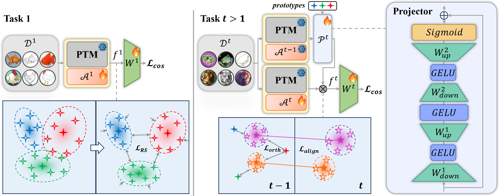

# Representation-Steered Incremental Adapter-Tuning for Class-Incremental Learning with Pre-Trained Models

This repository serves as the official implementation corresponding to the paper titled "Representation-Steered Incremental Adapter-Tuning for Class-Incremental Learning with Pre-Trained Models". 


## Installation
### Requirements
- OS: Ubuntu 20.04/22.04 LTS or Windows
- Python: >= 3.10 (tested and optimized up to Python 3.13)
- CUDA: >= 11.8 (tested and optimized up to CUDA 13.0)

Installation instructions and package dependencies are available in `requirements.txt`.
```bash
# 1. Install PyTorch with CUDA 13.0 support on Python 3.13:
pip install torch torchvision --index-url https://download.pytorch.org/whl/cu130

# 2. Install remaining dependencies:
pip install -r requirements.txt
```

### Data preparation

The overall directory structure should be:
```
RSIAT/
├──data/
├──datasets/
│   ├──cifar-100-python/
│   ├──cub/
│   ├──imagenet-a/
│   ├──imagenet-r/
│   ├──omnibenchmark/
│   ├──vtab/
│   ......
├──.......
```

## Training and evaluation

The training and evaluation instructions for each dataset are in the "./args.sh" file. Each dataset can be calculated separately, and the results are stored in the "./logs" folder.

## Citation

If you find this useful in your research, please consider citing:

```text
@inproceedings{zhao2026representation,
  title={Representation-Steered Incremental Adapter-Tuning for Class-Incremental Learning with Pre-Trained Models},
  author={Zhao, Jiarui and Huang, Libo and Li, Xiangqi and An, Zhulin and Yang, Chuanguang and Wang, Yu and Diao, Boyu and Xu, Yongjun},
  booktitle={Proceedings of the IEEE/CVF Conference on Computer Vision and Pattern Recognition},
  pages={18010--18020},
  year={2026}
}
```

## Acknowledgement

This repo is based on [PILOT](https://github.com/LAMDA-CL/LAMDA-PILOT) and [SSIAT](https://github.com/HAIV-Lab/SSIAT).

Thanks for their wonderful work!!!
